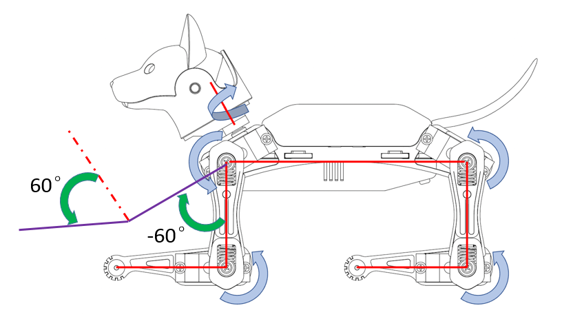

# Lab 01: Robot fundamentals and safe first commands

## Start here
A robot is a chain of sensing, decisions and actuation. In Bittle, the computer or onboard controller chooses a command, the firmware turns it into servo targets, and the mechanism moves. The IMU measures angular motion and acceleration; it is not a direct measurement of every joint angle or the robot's position in a room.

Your first goal is a repeatable command-and-response experiment, not a stunt. You can learn the protocol with a mock before powering any robot.

## What you will learn
- Distinguish a joint, link, actuator, sensor and controller.
- Read the channel map and explain why a channel number is not an angle.
- Connect to a mock, recognize command acknowledgments, and plan a safe hardware session.

## Equipment and prerequisites
Use a computer with Python and a terminal. The Linux mock exercises also use a pseudo-terminal. Physical practice additionally needs a compatible Bittle/Bittle X, its correct firmware and power supply, and the manufacturer's calibration procedure. This repository's recorded hardware is Bittle X with BiBoard/OpenCatEsp32. Check your own board before treating an example as universal.

## 1. Understand the mechanism
A link is a rigid part; a joint permits relative motion. A servo combines a motor, gearing and a local position controller. An angle target tells that local controller where to move, not how much torque to apply directly.

OpenCat allocates 16 logical channels. The eight leg channels used here are: 8 front-left shoulder, 9 front-right shoulder, 10 back-right hip, 11 back-left hip, 12 front-left knee, 13 front-right knee, 14 back-right knee, 15 back-left knee. Optional head channels are separate. Draw the robot from above and label left/right from the robot's perspective, not the camera's.


*Documentation image: Petoi Doc Center, [robot joint index](https://docs.petoi.com/petoi-robot-joint-index). Use the board-specific diagram and calibration guide for your unit.*

## 2. Install and try a virtual robot
From a local checkout of this repository:
```bash
python3 -m venv .venv
source .venv/bin/activate
python -m pip install -e .
python bittle_cli.py list
```
On Windows, activate the virtual environment using its Scripts directory instead. The PTY part of the mock is a Unix workflow; use a compatible Linux environment for this course's tested mock route.

Open two terminals in the repository and activate the same environment in both:
```bash
# Terminal A: leave this running
python mock_bittle.py --ws-port 8081 --serial-link /tmp/ttyBittle
```
```bash
# Terminal B: a loopback address, not a physical robot
python bittle_cli.py --wifi ws://127.0.0.1:8081 ksit
python bittle_cli.py --wifi ws://127.0.0.1:8081 kbalance
python bittle_cli.py --wifi ws://127.0.0.1:8081 stop
```
Observe the mock's command log and the CLI's confirmation. The mock checks communication behavior; it does not model balance, servo loads, collisions or battery safety. A successful mock command cannot certify a motion for hardware.

## 3. Prepare hardware separately
Read [Petoi's calibration instructions](https://docs.petoi.com/joint-calibration). Use the recommended calibration support, a clear working area and supervision. Keep fingers away from joints. Know how to remove power safely before sending motion. The CLI's `stop` sends `d`, which relaxes the servos; it is not a power-isolating emergency stop and may let a supported pose collapse.

Close other BLE clients before connecting. Discover your own device with `python bittle_cli.py scan`; do not copy the author's BLE address. Wait for initialization/Ready before motion. Start with calibrated, low-risk built-in postures under the manufacturer's procedure. Do not begin with a flip, handstand or arbitrary joint limit sweep.

## Check your understanding
1. Why can a correct token acknowledgment coexist with a mechanically unsafe motion?
2. Which sensor would you need to estimate body orientation? Which states are still not directly observed?
3. Why should you label left/right before building a simulation joint map?

## Submit
A labeled joint sketch, three mock command/response pairs, and a short hardware preflight checklist. Pass when you can explain what `stop` does and what the mock does not test.

## Continue
[Lab 02: Terminal control, protocols and motion sequences](Lab02_OpenCat_CLI_and_Terminal_Control.md)

## Original project reference
The original lesson is preserved as a dated project record, including its commands, observations and experimental results: [read the original Lab 01](reference/Lab01_Initializing_and_Programming_Bittle.md). Historical status statements belong to that record, not a live hardware assessment.
