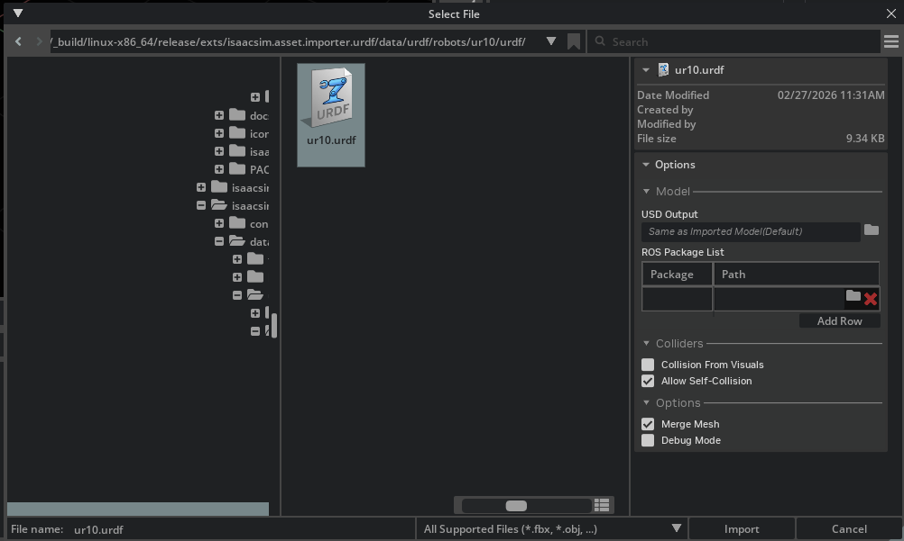

# Lab 03: Import Bittle into Isaac Sim and validate the model

## Start here
A URDF describes a robot's links, joints, geometry and inertial properties. USD is the scene/asset format used by Isaac Sim. Importing a mesh that looks like Bittle is only the beginning: a useful simulation needs correct scale, articulation, contacts, joint directions and actuators.

## What you will learn
- Import the repository's URDF through Isaac Sim's documented importer.
- Separate a visual asset from a physically validated articulation.
- Diagnose scale, root and joint-sign errors before learning a policy.

## Before you start: choose a version lane
The repository records an Isaac Sim 6.2 / Isaac Lab 3.0 workstation workflow and an older 4.5.0 GUI. NVIDIA's current online documentation can move independently. Record your installed versions and use matching documentation. The old PyQt/extension screenshots are historical context, not a current installation recipe. Import UI labels may differ by release.

## 1. Inspect the source before import
Open `assets/urdf/urdf/bittle.urdf`. Identify one parent/child joint, its axis and limit, one mesh reference, and one inertial element. Keep the whole URDF package together so relative/package mesh paths resolve. Read the console if meshes are missing; do not replace collision or inertia data with arbitrary values to hide an import error.

## 2. Import through Isaac Sim
1. Start the matching Isaac Sim release and a new stage. Save your work in a new writable project directory, not over the supplied asset.
2. Open **File > Import** and select `assets/urdf/urdf/bittle.urdf`. If URDF support is absent, use **Window > Extensions** to enable `isaacsim.asset.importer.urdf`.
3. Set a writable USD output location. Resolve package paths if requested. Keep the generated USD and its referenced meshes/configuration together.
4. Review collision, fixed-base and drive settings. Bittle is a floating-base legged robot, not a bench-mounted arm. Do not carry a fixed-base arm example into a locomotion task. Choose position drives for an intentional position-controlled scene, or no imported drives where the later task's actuator supplies control. Avoid two competing controllers.
5. Import, then read the Output Log. Open the generated stage and inspect the hierarchy before pressing Play.

*Documentation image: NVIDIA, [Tutorial: Import URDF](https://docs.isaacsim.omniverse.nvidia.com/latest/importer_exporter/import_urdf.html). The pictured asset is UR10, not Bittle. It illustrates the importer controls only; the Bittle-specific choices are described in this lesson.*

NVIDIA's [URDF importer reference](https://docs.isaacsim.omniverse.nvidia.com/latest/importer_exporter/ext_isaacsim_asset_importer_urdf.html) explains the options. Its arm example's self-collision selection is not a universal Bittle setting. Begin with the configuration your Bittle task expects and document any change.

## 3. Validate the articulation
Show collision geometry using the viewport eye menu, **Show by type > Physics > Colliders > All** in the documented UI. Confirm collision shapes fit the intended contact surfaces. Inspect the composed stage for one intended articulation root; this repository's corrected assets use `/bittle`. Duplicate root APIs caused spawning problems in the author's original conversion.

Place the robot above a ground plane, enable gravity and use a suitable physics scene. Begin with a single environment. Check that the initial pose is above the floor without interpenetration and that feet, rather than unintended links, support the robot. Keep this a simulation exercise until the model checks pass.

## 4. Measure scale and mass
This repository includes both `assets/usd_10x/` and `assets/usd_real_1x/`. They are not interchangeable training assets. The author's real-scale reference is about 10.42 cm wheelbase and 0.271 kg total mass; the larger legacy asset has different dynamics and actuator settings. Inspect the stage's units and measured dimensions, not just its visual size in the viewport.

For the author's conversion with mass held fixed, multiplying all lengths by 0.1 requires inertia to scale by 0.01. Changing the display transform alone does not prove that joint offsets, collision shapes, center of mass and inertia changed consistently. Use the supplied corrected stage as a comparison while keeping your own import output separate.

## 5. Verify every joint
List joint names and limits. Command one simulated joint at a time with a small target change and record its direction. The supplied USD has mirrored right-knee frames; the real-scale initial pose uses left knees +0.4 rad and right knees -0.4 rad. Treat this as asset-specific, not a universal servo sign rule. Build the mapping table used in Lab 04.

## Submit
A screenshot of your imported Bittle, the articulation-root path, measured wheelbase/mass, collision view and eight-joint direction table. Pass only when you can explain which asset and scale your next task will use. No GPU training run is required for this checkpoint.

## Continue
[Lab 04: Build tasks and connect the real robot to simulation](Lab04_Real_to_Sim_and_Sim_to_Real.md)

## Original project reference
The original lesson is preserved as a dated project record, including its commands, observations and experimental results: [read the original Lab 03](reference/Lab03_URDF_USD_and_Simulation_Setup.md). Historical status statements belong to that record, not a live hardware assessment.
