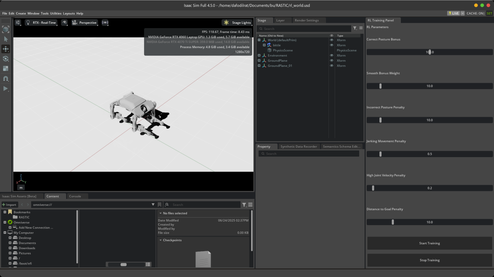
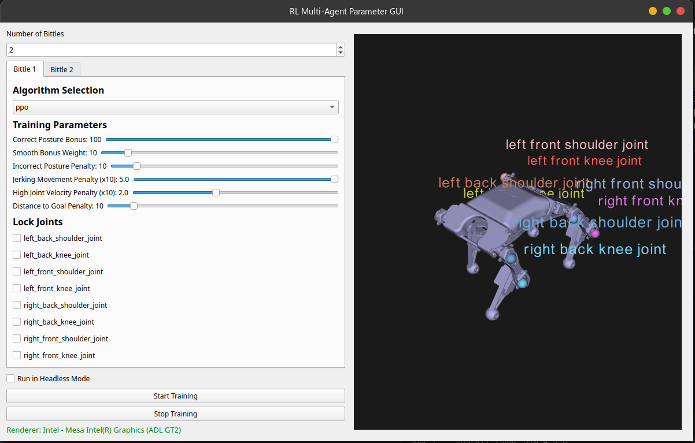
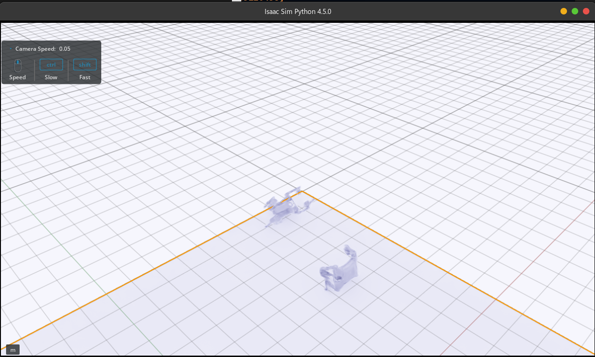

# Lab 03: Bittle URDF, USD Conversion, Scale Fixes & Legacy Isaac Sim

## Learning Objectives
By the end of this lab, you will be able to:
1. Inspect Petoi Bittle's URDF kinematics, link masses, and joint limits (`assets/urdf/`).
2. Convert and validate the Bittle USD stage for Isaac Sim 6.2 / Isaac Lab 3.0 (`assets/usd_10x/` vs `assets/usd_real_1x/`).
3. Identify and fix three critical USD pitfalls: duplicate `ArticulationRootAPI`, `10×` decimeter scaling (`100×` inertia error), and mirrored right-knee `rot0` joint signs.
4. Review the legacy Isaac Sim 4.5.0 PyQt5/extension setup (`training/legacy_isaac_sim_4_5/` and `assets/images/`).

---

## 1. Bittle URDF Anatomy (`assets/urdf/`)

The repository includes the full URDF package from `Bittle-IsaacSim/Bittle_URDF`:
- [bittle.urdf](../assets/urdf/urdf/bittle.urdf) and [bittle.stl](../assets/urdf/urdf/bittle.stl) (`16 MB`)
- Low-poly `.obj` visual/collision meshes in [assets/urdf/meshes/obj/](../assets/urdf/meshes/obj/)
- Reference joint locations ([joint_locs.txt](../assets/urdf/joint_locs.txt)) and Isaac Gym test script ([joint_monkey.py](../assets/urdf/joint_monkey.py))

### Coordinate Frame & Measured Masses
In `base_frame_link` local coordinates:
- **Front** is **`+Y`** (`y = +0.5226` in URDF / `usd_10x`, `+0.0523 m` in `usd_real_1x`)
- **Back** is **`-Y`** (`y = -0.5192` in URDF / `usd_10x`, `-0.0519 m` in `usd_real_1x`)
- **Left / Right** is **`-X` / `+X`** (`-0.4460` / `+0.4515` in URDF)
- **Up** is **`+Z`**
- **Weighed Link Masses (real kg):** `base_frame_link = 0.179 kg`, `4 × shoulder_link = 0.006 kg` each, `4 × knee_link = 0.017 kg` each (**Total = `0.271 kg`**).

---

## 2. Three Critical USD Bugs & How We Fixed Them

### Bug 1: Duplicate `ArticulationRootAPI` (Blocks Isaac Lab Spawning)
The raw USD inside `Bittle_URDF/bittle/` had `PhysicsArticulationRootAPI` applied to **both** `/bittle` and `/bittle/base_frame_link` in `bittle.usd` and `configuration/bittle_physics.usd`.
- **Fix (`assets/usd_10x/`):** Stripped `PhysicsArticulationRootAPI` from `/bittle/base_frame_link`, leaving `/bittle` as the sole articulation root.

### Bug 2: `10×` Decimeter Geometry vs `1×` Kilogram Mass
The original URDF/USD exported CAD dimensions in decimeters (`1.04 m` wheelbase, `0.58 m` standing height) while keeping real `0.271 kg` masses. This caused:
- `100×` inflated rotational inertia (`0.0217` vs `0.000217 kg·m²` on torso)
- $\sqrt{10} \approx 3.16\times$ slower gravitational tipping dynamics than the physical dog!
- **Fix (`assets/usd_real_1x/`):** Scaled all mesh vertices/extents, translations, joint `localPos0/1`, and `centerOfMass` by **`0.1`** and `diagonalInertia` by **`0.01`**, preserving exact `0.271 kg` masses:
  - Torso: `9.8 cm × 12.9 cm × 3.6 cm`, `10.42 cm` wheelbase, `4.92 cm` thigh, `5.56 cm` shin.

### Bug 3: Mirrored Right-Knee `rot0` Sign Inversion
Inspecting USD joint frames revealed:
- `left_front_knee_joint`, `left_back_knee_joint`: `localRot0 = (1, 0, 0, 0)`
- `right_front_knee_joint`, `right_back_knee_joint`: `localRot0 = (0, 0, 0, 1)` (`180°` Z rotation!)

Setting `.*_knee_joint = +0.2` bent left knees **down** onto the paws and right knees **up** onto the right elbows (`right_back_shoulder_link = 1.11 N`).
- **Fix:** Initialize symmetrically with `left_.*_knee_joint = +0.4`, `right_.*_knee_joint = -0.4` at `z = 0.074 m` → all four `*_shoulder_link` contact forces drop to **`0.0000 N`**.

---

## 3. Legacy Isaac Sim 4.5.0 Setup (`training/legacy_isaac_sim_4_5/`)

Earlier work used `Dafodilrat/Bittle-IsaacSim` (Isaac Sim 4.5.0 + Stable-Baselines3 PPO/DDPG/TD3/A2C + PyQt5 GUI):

| Isaac Sim Scene | PyQt5 Trainer | Training Viewport |
|---|---|---|
|  |  |  |

**What Didn't Work:** The `RL Viewport` Omniverse extension (`exts/customView/customView/ext.py`, shown in [extension.png](../assets/images/extension.png)) broke due to Isaac Sim API changes and was superseded by the Isaac Lab 3.0 workflow in **Labs 05 & 06**.

---

## Verification Checklist
- [ ] Verify `/bittle` is the only `PhysicsArticulationRootAPI` in `assets/usd_10x/bittle.usd` and `assets/usd_real_1x/bittle.usd`
- [ ] Confirm `assets/usd_real_1x/bittle.usd` bounding box shows `~10.4 cm` wheelbase and `0.271 kg` total mass
